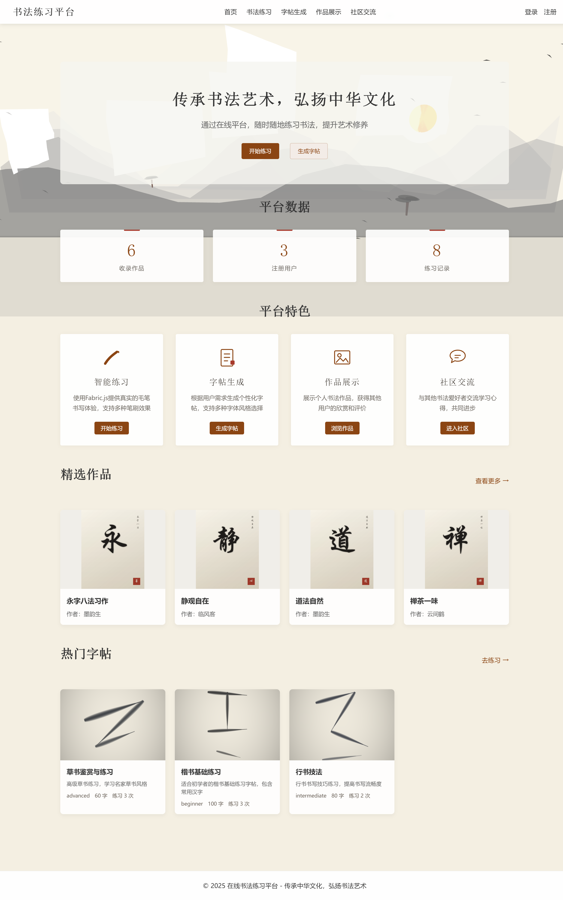
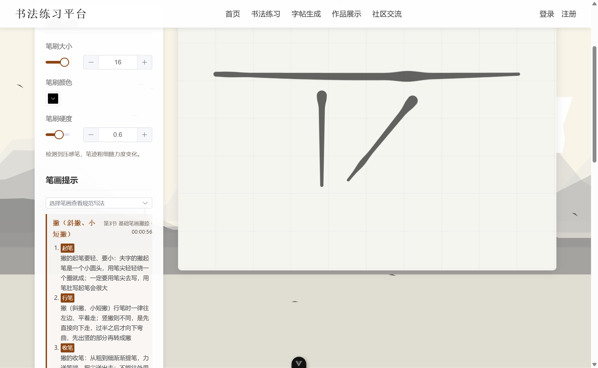
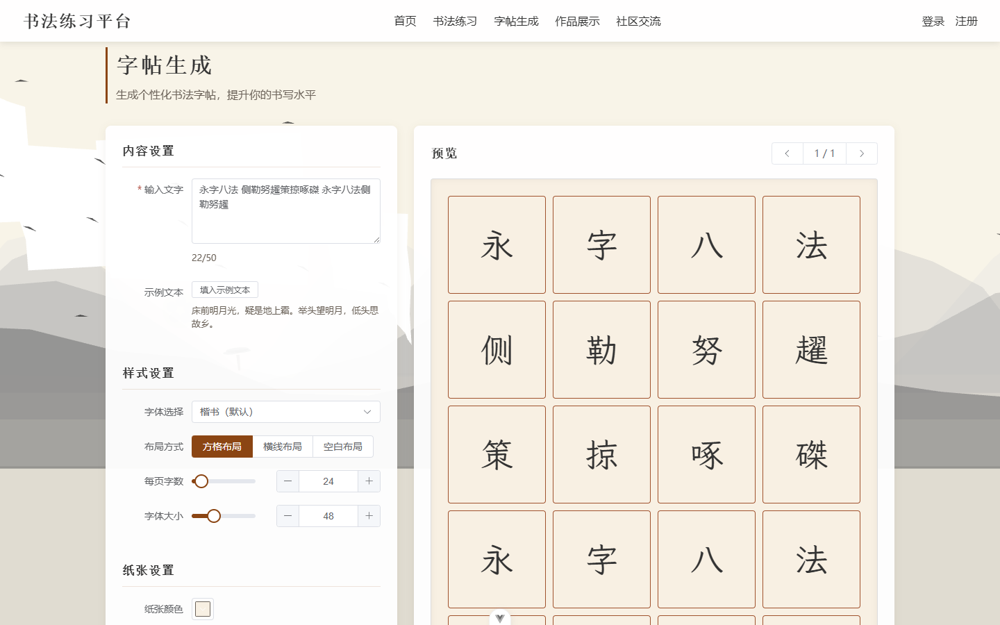
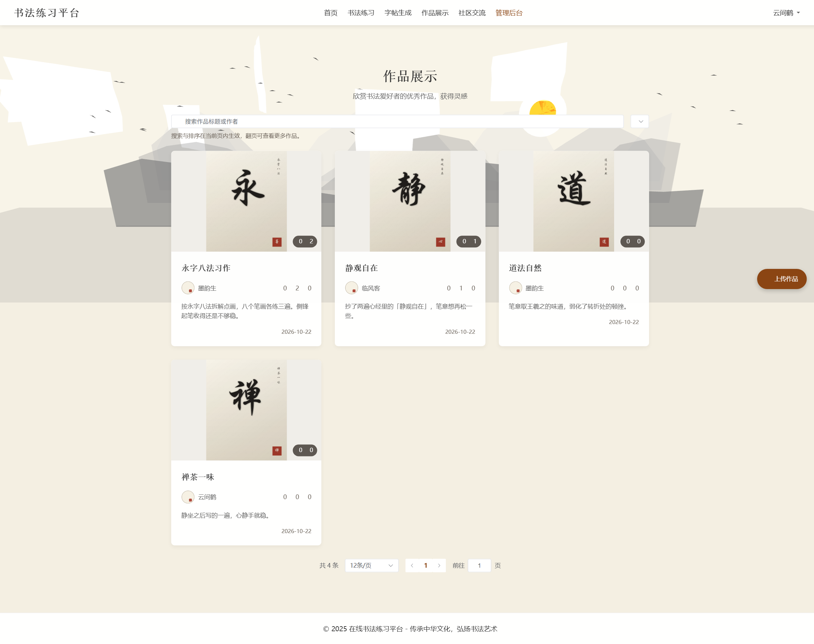
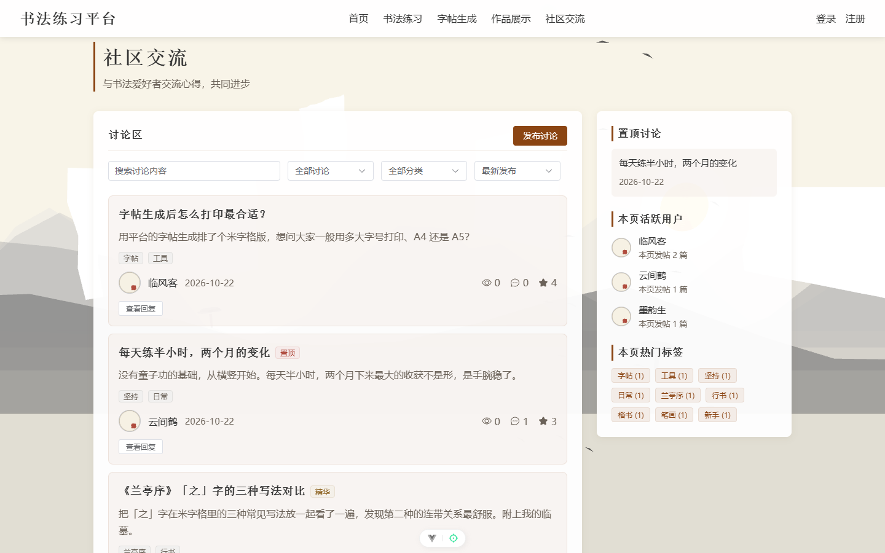
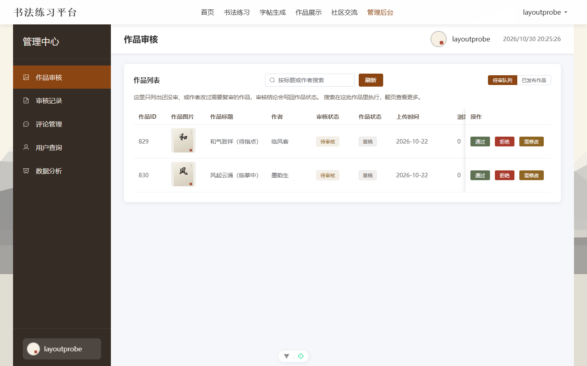

<div align="center">



# 书法练习平台 · Calligraphy Practice

**在线书法练习与交流平台** —— 毛笔手感练习、笔顺引导、字帖生成与云端保存、作品展示、社区互助。

[](https://cn.vuejs.org/)
[](https://vite.dev/)
[](https://element-plus.org/)
[](https://spring.io/projects/spring-boot)
[](https://www.mysql.com/)
[](https://redis.io/)
[](LICENSE)

[功能特性](#功能特性) · [界面预览](#界面预览) · [工程特点](#工程特点) · [技术栈](#技术栈) · [快速开始](#快速开始)

</div>

---

## 功能特性

**毛笔练习** — 自研笔输入层：压感笔的**笔压真实改变笔迹粗细**（鼠标按运笔速度映射粗细，按住 Shift 可加粗），**手掌搭在屏上不会误画**；画布随屏幕尺寸与像素密度自适应，宣纸底色配方格 / 田字格 / 横线三种格线。撤销以「一笔」为单位，切后台或刷新回来笔迹还在；**写完一笔即给出该笔画的起笔、行笔、收笔写法与顿点位置**。

**笔顺引导** — 选一个字，画布上直接画出规范笔顺轨迹并标出**当前这一笔的落笔点**；写完一笔自动判定落笔位置、走向、收笔位置与形状偏离，通过就推进到下一笔，不通过就指出差在哪。覆盖 9574 个常用汉字的笔顺顺序与走向轨迹。

**书法知识库** — 从五门课程的字幕逐句抽取并核对：笔画 116 种（含起笔 / 行笔 / 收笔逐段拆解）、结构规律 538 条、常见错误 1299 条、写字观 1059 条、术语 975 条，每条都能回查到原话与时间码。按楷书 / 硬笔 / 隶书 / 行书分线，互不混用。

**字帖生成** — 输入任意文字，选字体、布局、字号与纸张配色，实时生成方格 / 横线 / 空白三种版式，可翻页预览与下载 PNG；生成结果**同时存进账号**，换设备登录也能在「我的字帖」里找到。

**作品展示** — 公开画廊按服务端分页展示已通过审核的作品，支持按标题 / 作者检索与多种排序；作者可上传、编辑、删除自己的作品，并查看浏览量与评论。

**社区交流** — 讨论区支持发帖、回复、点赞、置顶与精华标记，按分类和标签聚合；附带热门讨论、活跃用户、热门标签侧栏，以及作品评论与后台审核。点赞状态存在服务端，刷新页面不会丢。

**个人中心** — 修改资料与头像，查看自己的作品与练习记录，记录带时长 / 字数 / 难度统计；练习偏好存在账号里，换设备登录同步生效。

**管理后台** — 作品审核分「待审队列」与「已发布作品」，审核结论实时回写作品状态；另有审核记录、评论管理、用户查询与数据分析看板。

---

## 界面预览

<table>
<tr>
<td width="50%"></td>
<td width="50%"></td>
</tr>
<tr>
<td align="center"><b>毛笔练习</b> —— 提按笔锋与格线背景</td>
<td align="center"><b>字帖生成</b> —— 版式实时预览与我的字帖</td>
</tr>
<tr>
<td width="50%"></td>
<td width="50%"></td>
</tr>
<tr>
<td align="center"><b>作品展示</b> —— 公开画廊</td>
<td align="center"><b>社区交流</b> —— 讨论区</td>
</tr>
<tr>
<td colspan="2"></td>
</tr>
<tr>
<td colspan="2" align="center"><b>管理后台</b> —— 作品审核与待审队列</td>
</tr>
</table>

---

## 工程特点

**契约即门禁** — 前后端共用一份 OpenAPI 3.1 契约（[`Practice-Platform/openapi/contract.yaml`](Practice-Platform/openapi/contract.yaml)），配一个自研检查器做三方比对：**前端实际调用点 ↔ 契约声明 ↔ 后端已注册路由**。任何一端单方面改动都会在 `npm run build` 前被拦下（路径、参数名、端点缺失、桩实现都会被点名）。人读版契约见 [`docs/api-contract.md`](docs/api-contract.md)。

**可核验的行为** — 列表分页、关键词检索、排序、浏览量、审核状态回写、点赞态、练习统计，全部在数据库层完成并从库里读回；不是前端过滤出来的假数据。

**明确的权限边界** — 作品、评论、字帖的读写都校验归属；JWT 令牌声明的 `userType` 与访问的路径族必须一致（前端登录的令牌进不了管理端接口）；他人的登录 IP、失败次数、锁定时间只对本人与管理员可见。

**229 项后端测试** — 覆盖端点的状态码与响应字段，测试跑在独立的 `calligraphy_practice_test` 库上，不碰开发数据。

**101 项前端测试** — 笔输入层的宽度曲线、笔画几何、手掌状态机、笔画栈、草稿存储、笔画走向判别、笔顺匹配的落笔与走向判定都是纯函数，逐个用例锁住行为（`npm test`）。

**按需加载的前端** — Element Plus 逐组件按需引入，首屏 JS gzip 后约 189 kB、CSS 约 8 kB（gzip）。

---

## 技术栈

| | 技术选型 |
|---|---|
| **前端** | Vue 3.5 · Vite 7 · Vue Router 4 · Pinia 3 · Element Plus 2.11（按需引入）· fabric.js 6 · Three.js |
| **后端** | Spring Boot 3.2.5 · Spring Security · Spring Data JPA（Jakarta）· JWT（jjwt）· MapStruct · Lombok |
| **存储** | MySQL 8.0（用户 / 作品 / 社区 / 审核）· Redis 6+（令牌黑名单、身份缓存）· 本地文件（图片、头像） |
| **契约** | OpenAPI 3.1 单一真相源 · 56 个端点 · 自研一致性检查器 · 人读版见 [`docs/api-contract.md`](docs/api-contract.md) |
| **工程** | JUnit 5 + MockMvc 契约测试（229 项）· ESLint + Prettier · Maven 3.9 / Node 20.19+ |

---

## 快速开始

### 1. 环境要求

| 组件 | 版本 |
|---|---|
| JDK | 17+ |
| Maven | 3.9+ |
| Node.js | 20.19+ / 22.12+ |
| MySQL | 8.0 |
| Redis | 6+ |

### 2. 准备数据库

```sql
CREATE DATABASE calligraphy_practice DEFAULT CHARACTER SET utf8mb4 COLLATE utf8mb4_general_ci;
```

### 3. 配置密钥（必做）

**仓库里不含任何真实密钥** —— JWT 签名密钥一旦泄露，任何人都能伪造管理员令牌。

```powershell
cd SpringBoot-Platform
Copy-Item 'config\local-secrets.properties.example' 'config\local-secrets.properties'
```

编辑 `config\local-secrets.properties`，填两项（该文件已被 `.gitignore` 忽略，不会进版本库）：

```properties
JWT_SECRET=<至少 32 字符，建议 openssl rand -hex 32>
DB_PASSWORD=<你的 MySQL 密码>
```

### 4. 启动后端（8083）

```powershell
cd SpringBoot-Platform
.\run-local.ps1              # 启动；脚本会把上面的密钥读进环境变量注入进程（从不回显）
.\run-local.ps1 -Task test   # 跑测试
```

> 测试跑在独立的 `calligraphy_practice_test` 库上（首次会自动建库），不会动到你的开发数据。

> 直接跑 `mvn spring-boot:run` 也行，但要自己先设好 `JWT_SECRET` 与 `DB_PASSWORD` 两个环境变量，否则启动会明确报错：
> `IllegalStateException: JWT 密钥未配置`。

### 5. 启动前端（5174）

```powershell
cd Practice-Platform
npm install
npm run dev
```

`vite.config.js` 已把 `/api` 代理到 `http://localhost:8083`，前后端一起跑即可联调。
打开 <http://localhost:5174/>。

> `npm run build` 会先跑一遍契约一致性检查（`contract:check`），不一致就直接失败。

### 6. 创建第一个管理员

新装的库里**没有任何管理员**（默认口令已移除）。注册一个账号后把角色提上去：

```sql
UPDATE users SET role='SUPER_ADMIN' WHERE username='你的用户名';
```

令牌过滤器会缓存用户的身份与权限（TTL 60 秒）；**改密码、账号状态变更会主动让缓存失效**，而直接改库里的角色，最多 60 秒后生效。

---

## 关于本项目

项目定位、面向人群与设计取向见 [`docs/about.md`](docs/about.md)。

---

## License

[Apache License 2.0](LICENSE)
